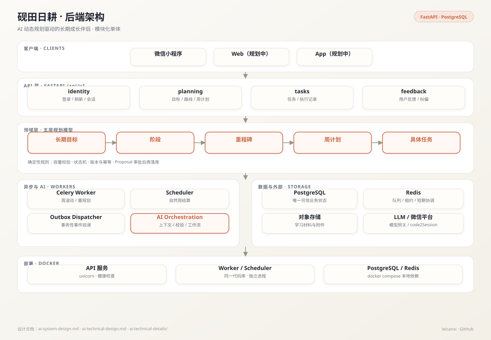
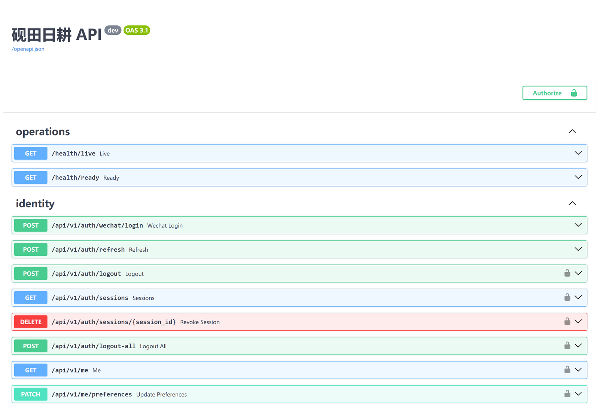

<div align="center">
  <h1>砚田日耕 · Inkfield</h1>
  <p><strong>以 AI 动态规划为核心的长期成长伴侣</strong></p>
  <p>用户只负责「做」，AI 负责「怎么安排」</p>

  <p>
    
    
    
    
    
    
  </p>

  <p>
    <a href="#产品理念">产品理念</a> ·
    <a href="#架构">架构</a> ·
    <a href="#快速开始">快速开始</a> ·
    <a href="#设计文档">设计文档</a> ·
    <a href="#当前进度">当前进度</a>
  </p>
</div>

## 产品理念

打卡软件的本质是「记录 + 激励」：用户规划、用户执行、用户承担失败，软件只负责记录。砚田日耕反过来——**系统为用户服务**。

用户不做任何与成长内容无关的决策：不规划、不分析数据、不调整计划。AI 在后台持续完成规划、追踪与修正，用户打开产品看到的就是「这周该做什么」。

> 一个想长期成长但规划能力弱的人，最需要的不是更多意志力，而是一个能盯着进度、理解状态、动态调整计划的「博士生导师」。

## 产品结构

系统采用 **五层规划模型**，解决「长期目标很遥远，日计划又太琐碎」的问题：

```text
长期目标  →  阶段  →  里程碑  →  周计划  →  具体任务
  方向        路径      检查点      节奏        行动
```

核心运行原则：

> 长期有方向，近期有安排；当前周稳定，预备周可调；完成一周，再向前规划一周。

系统只生成**当前执行周 + 下一预备周**的具体任务，不会提前制造几个月后的虚假任务，也不会因为一天的波动重建长期路线。

## 架构

<p align="center">
  
</p>

后端是**模块化单体**，不是微服务：

- 一个 FastAPI API 服务；
- 一个或多个 Celery Worker；
- 一个定时调度进程；
- 三者共享领域模型与业务代码，模块间通过应用服务接口协作；
- PostgreSQL 是唯一可信业务状态，Redis 只用于队列、租约与短期协调。

这样做的原因是：当前规模（数千至数万用户）不需要微服务的复杂度，但需要清晰的模块边界，以便未来按模块拆分。

## 界面 / API 文档

<p align="center">
  
</p>

本地启动后访问 `/docs` 可查看完整 OpenAPI（26 个端点）。截图来自实际运行的实例。

## 核心设计

### 1. AI 建议与确定性规则分离

AI 负责「怎么安排」，不负责「能不能落库」。所有 AI 输出都要经过后端校验：

- 容量是否超配；
- 截止日期是否可达；
- 任务依赖是否成环；
- 状态迁移是否合法；
- 目标、截止、长期容量等变更是否获得用户确认。

### 2. Proposal 审批，而不是静默修改

普通解释、追问和低风险自动调整不打扰用户；涉及目标、截止、长期容量、跨周关键调整的 Proposal 必须显示「同意 / 拒绝」。用户同意后，后端重新校验版本、容量与前置条件，再原子落库；冲突时提示刷新，不部分应用。

### 3. 状态机与历史冻结

项目、任务、周计划都有显式状态机。非法迁移直接拒绝，不靠「前端不展示」来约束。路线读取固定区分 current、冻结 history 与 tentative future；completed 只来自用户显式确认，deadline close 不会伪装成完成。

### 4. 幂等、乐观并发与事务性 Outbox

- refresh token 只保存 SHA-256 哈希，敏感请求重新校验版本；
- API 写入与领域事件都使用幂等键；
- Task 更新使用 expected version 做乐观并发；
- 领域事件通过事务性 Outbox 投递，避免「业务成功、消息丢失」。

### 5. 架构边界可执行

`scripts/check_architecture.py` 扫描模块依赖，禁止跨模块直接修改数据。架构约束不是文档里的口号，而是 CI 可执行的检查。

### 6. 固定自然周

统一使用 `Asia/Shanghai` 进行自然周结算，避免跨时区导致「同一周」定义不一致。

## 当前进度

### 已实现

- ✅ 身份模块：微信登录、refresh 轮换、会话查询 / 撤销、全部退出、`/me`、偏好 revision
- ✅ 项目与路线：创建、列表、详情、允许字段更新、路线与关闭快照、pause / resume / complete / archive
- ✅ 容量分配：周容量、AllocationSet 版本、最低预算与期望预算、paused 排除、容量不足标记
- ✅ 周计划与任务：current WeekPlan 唯一约束、Task 状态机、TaskEvent 幂等、累计耗时、依赖 DAG 与阻塞派生
- ✅ 健康检查、结构化日志、关联 ID、统一错误响应
- ✅ 单元 / 契约测试 64 项，ruff + mypy strict + 架构检查通过

### 进行中 / 规划中

- 🚧 AI 编排工作流：上下文构建、模型网关、结构化输出校验、周滚动重规划
- 🚧 每周回顾与跨周任务滚动
- 🚧 反馈闭环（用户纠偏 → 计划调整）
- 🚧 微信小程序 / Web / App 客户端
- 🚧 真实 PostgreSQL / Redis 集成测试与并发验证

> 说明：本仓库当前交付的是**后端核心**，前端与完整 AI 工作流仍在设计与实现中。设计文档先行，避免用代码掩盖未想清楚的状态与边界。

## 快速开始

### 依赖

- Python 3.12
- PostgreSQL 16
- Redis 7
- Docker（可选，用于本地依赖）

### 启动

```bash
cd backend
cp .env.example .env

# 启动 PostgreSQL / Redis
docker compose up -d postgres redis

python -m venv .venv

# Linux / macOS
. .venv/bin/activate
# Windows PowerShell
# .venv\Scripts\Activate.ps1

python -m pip install -c requirements.lock -e ".[dev]"
alembic upgrade head
uvicorn app.main:create_app --factory --reload
```

检查：

```bash
curl http://localhost:8000/health/live
curl http://localhost:8000/health/ready
```

`/health/ready` 会检查 PostgreSQL 与 Redis；未启动依赖时返回未就绪。

### 环境变量

| 变量 | 说明 |
|---|---|
| `DATABASE_URL` | 必须使用显式 PostgreSQL 驱动，如 `postgresql+psycopg://...` |
| `REDIS_URL` | `redis://` 或 `rediss://` |
| `TOKEN_SIGNING_KEY` | 至少 32 字符；生产环境从密钥管理系统注入 |
| `APP_ENV` | `local` / `test` / `staging` / `production` |
| `APP_VERSION` | 版本号，写入 OpenAPI |
| `LOG_LEVEL` | 日志级别 |

### 质量检查

```bash
ruff check .
ruff format --check .
mypy app tests
python scripts/check_architecture.py
pytest
```

集成测试需要真实 PostgreSQL / Redis；单元测试不得隐式连接外部服务。

## API 概览

| 模块 | 路径 | 能力 |
|---|---|---|
| 身份 | `/api/v1/auth/*` | 微信登录、refresh、logout、会话管理 |
| 用户 | `/api/v1/me` | 当前用户、偏好 revision |
| 项目 | `/api/v1/projects/*` | 创建、列表、详情、路线、关闭、pause/resume/complete/archive |
| 周容量 | `/api/v1/user-weeks/*` | 当前 / 指定周、容量分配 |
| 周计划 | `/api/v1/week-plans/*` | 当前周计划与任务 |
| 任务 | `/api/v1/tasks/*` | 当前周、列表、详情、事件写入 |

## 项目结构

```text
backend/
├── app/
│   ├── api/                 # 健康检查
│   ├── core/                # 配置、时钟、错误、可观测性
│   ├── infrastructure/      # 数据库、Redis、Celery、Outbox
│   └── modules/
│       ├── identity/        # 登录、令牌、会话、偏好
│       ├── planning/        # 项目、路线、容量、周计划、任务
│       ├── tasks/           # 任务事件与状态
│       ├── feedback/        # 反馈闭环
│       └── ai_orchestration/# 上下文、模型网关、校验、工作流
├── migrations/              # Alembic
├── tests/                   # unit / contract / integration / e2e / evaluation
├── evidence/                # 每批任务的验证记录
└── scripts/                 # 架构边界检查
```

## 设计文档

- [产品设计文档](砚田日耕产品设计文档_0706221409.md)：产品理念、用户画像、交互与视觉
- [AI 系统设计](ai-system-design.md)：五层规划、AI 权责边界、异常处理
- [技术方案](ai-technical-design.md)：总体架构、技术选型、模块边界
- [技术细节](ai-technical-details/README.md)：数据模型、状态机、AI 工作流、异步实现
- [验证记录](backend/evidence/)：每批任务的静态检查、契约测试与未关闭项

## 设计取舍

- **先设计后编码**：状态机、幂等键、容量规则先写清楚，再实现，避免后期靠补丁修复一致性问题。
- **AI 不拥有真相**：模型可以提出计划，但不能绕过校验直接修改业务状态。
- **不追求短期留存指标**：不设「连续打卡 X 天」这类施压机制，关注三年后用户是否还愿意打开。
- **避免过早微服务**：模块化单体 + 可执行边界检查，在需要时再拆。

## 联系

- GitHub: [leicanxi](https://github.com/leicanxi)
- 项目仍在早期，欢迎交流 AI 规划、状态机设计与模块化单体的实践。
